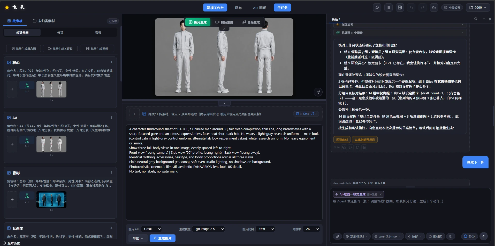
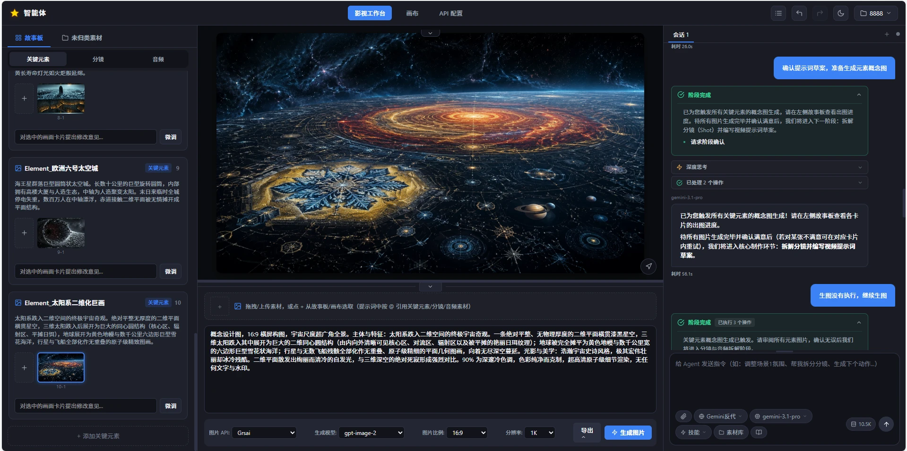
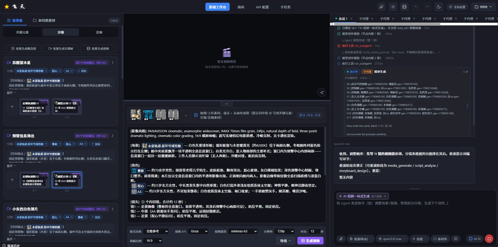

<p align="center">
  
</p>

<h1 align="center">FTDYB · 影视创作 Agent 工作台</h1>

<p align="center">由 <b>Skill 驱动流程</b>的对话式影视创作 Agent —— 制作流程写在文档里，不写死在代码里。</p>

> [!NOTE]
> **本项目仍在持续迭代**，尚未稳定，历史数据格式不保证兼容；不少地方仍有待改进。
> 欢迎提意见、报问题、给建议 —— 联系方式见文末。

## 它是什么

**一个以 Skill 作为视频制作流程、据此控制视频生产的 Agent。**

每套 Skill 是一份 Markdown 制作手册：开头两行说明名称与使用时机，正文用固定六节骨架写「目标与交付 / 项目结构 / 制片规格 / 创作流程 / 专业方法 / Reference 路由」，模板与细则拆到 `references/` 分册按需读取（形态对齐 Flova 新 skill）。
Agent 按手册推进「故事 → 剧本 → 分镜 → 关键帧 → 视频 / 音频」全流程，
素材与节点直接落到外部画布 [infinite-canvas](https://github.com/basketikun/infinite-canvas) 上。

平台自身只管两件事：提供执行动作的工具集，守住不可逾越的安全边界。**流程归 Skill，边界归平台。**

## Skill 如何驱动流程

一套 Skill = `data/skills/<名称>/SKILL.md` + `references/` 分册，由三部分组成：

| 部分 | 内容 | 作用 |
|---|---|---|
| frontmatter 声明 | `name` / `description` | 注册与拒载依据：声明不合格的包不进 Skill 目录、不可加载 |
| 主文档 | 六节骨架：目标与交付、项目结构、制片规格、创作流程、专业方法、Reference 路由 | **选中后整篇注入主代理**；超预算时注入开头 + 标题目录 + 分册清单 |
| `references/` 分册 | `媒体生成.md` / `提示词写作.md` / `剪辑交付.md`（可按包追加专属分册） | 正文给路径，用到才 `read_skill`，不提前占上下文；工作台可查看编辑 |

运行时的一条链：

1. **选中 Skill** —— 主代理拿到主文档全文（超预算给开头 + 标题目录 + 分册清单），分册不自动进场。
2. **推进到某阶段** —— 主代理把该阶段整段委派出去；子代理拿到同一份主文档全文，
   并可自行 `read_skill` 读分册。`stage` 只用于归组、建卡限定与遥测，不按阶段切章节。
3. **主代理是纯编排角色** —— 各专业阶段的写入工具对它结构性不可见，只能经委派触达；
   花钱的生成动作留在主线程，以便走确认闸。
4. **主文档即依据** —— 未被注入或显式读取的内容不构成依据；
   分册按正文给出的路径读取，不靠章节名猜。

**边界不可被 Skill 削弱。** Skill 规定流程怎么走，但平台硬边界（生成确认、工具风险分级、
阶段硬拦停）由平台机械执行：执行模式档位下，即使 Skill 正文写着「直通」也照停——
**档位优先于 Skill 散文**。

Skill 是产品数据源而非代码：用户可在工作台直接编辑、保存带版本留痕，**改文档即改流程**。

## Agent 自动完成的制作环节

选定 Skill 后，下列环节由 Agent 自动完成，不需要人工整理素材或拼提示词：

- **自动拆分剧本** —— 读完剧本自动拆出关键元素（角色 / 场景 / 道具）、逐镜分镜列表与音频层，
  落成故事板草稿卡；角色音色单独登记为音色卡并与该角色绑定。
- **自动写视频提示词** —— 按 Skill 规定的写法为每个镜头撰写视频提示词，要素按 Skill 要求补齐
  （如分镜表格图的运镜轨迹、景别与时长标注、机位示意）。
- **自动引用媒体素材** —— 分镜通过引用关系挂到对应关键元素上；生成时自动把该元素的概念图
  作为参考图、音色卡作为参考音频传给模型，不必手工挑图。

## 界面预览

左：故事板（关键元素 / 分镜 / 音频）· 中：画布 · 右：对话与子代理进度。

<table width="100%">
  <tr>
    <td width="50%"></td>
    <td width="50%"></td>
  </tr>
  <tr>
    <td align="center"><sub>关键元素：角色设定卡与批量生成入口</sub></td>
    <td align="center"><sub>概念图生成：阶段完成，等待确认</sub></td>
  </tr>
  <tr>
    <td colspan="2"></td>
  </tr>
  <tr>
    <td colspan="2" align="center"><sub>分镜与视频提示词：分镜卡标出引用的关键元素，右侧子代理正逐镜撰写提示词</sub></td>
  </tr>
</table>

## 内置画布（infinite-canvas）

画布（[infinite-canvas](https://github.com/basketikun/infinite-canvas)，MIT）已搬入
`vendors/infinite-canvas/`，构建为独立产物 `static/canvas-app/`，由本服务在 `/canvas-app/`
同域直出（`python scripts/build_canvas.py` 或 `npm run build:canvas`）。**不再需要另起 Node 进程**。

| 组成 | 是什么 | 本项目怎么用 |
|---|---|---|
| `vendors/infinite-canvas/web/` | 画布站点（React 19 + Vite 7） | 同域 iframe 嵌入，hash 引导 `#agentUrl` / `#agentToken` |
| `src/video_agent/web/routes/canvas_agent.py` | 本进程 agent 协议（原 canvas-agent 的替代） | SSE `tool_call` + `/canvas/state` + `/canvas/result` |
| `src/video_agent/adapters/canvas_agent_session.py` | 会话与工具翻译 | 高层工具 → `canvas_apply_ops`，等浏览器回执 |

**集成纪律（宪法 Rule 7）**：画布改动只允许登记在案的最小 patch 集（`LocalAgentPanel headless`、
basename、配色、`BASE_URL` 资源路径），完整清单见 `CHANGELOG.md`；画布数据仍在浏览器 IndexedDB，
服务端只经协议读写节点，无法直读原图/素材库；上游更新按最小 patch 集 rebase。

本项目侧全部画布代码收敛在 `src/video_agent/adapters/`：`infinite_canvas_backend.py`（实现）、
`canvas_adapter.py`（工厂）、`canvas_port.py`（端口）、`canvas_schema.py`（契约映射与工具白名单）、
`canvas_agent_session.py`（进程内会话）。

### 上游更新（增量同步，不必全量拉取）

```bash
# 1. 只看新上游改了什么（不动文件）
python scripts/sync_canvas_upstream.py --check --upstream <新版本目录>
# 2. 增量应用（只写变化的文件；有冲突默认整体中止）
python scripts/sync_canvas_upstream.py --apply --upstream <新版本目录>
# 3. 重建画布产物
python scripts/build_canvas.py
```

- 基线 `vendors/infinite-canvas/.canvas-sync.json` 记录每个文件的上游/本地 sha256：上游没变的文件
  一律不动，因此 6 个本地 patch（headless / basename / 配色 / BASE_URL）不会被覆盖。
- 上游改了 patch 同文件 → 报冲突不写文件，diff 落到 `vendors/infinite-canvas/.sync-conflicts/`；
  按 `CHANGELOG.md` 的 patch 清单人工重做后，用 `--init-baseline --force` 收口。
- `package.json` 有变时会提示重装依赖；锁文件与构建缓存不参与同步。
- 首次接手/重建基线：`--init-baseline <纯净上游目录> --version <版本号>`。

## 快速开始

需要**两个服务**：画布（3000）+ 本项目（8080）；画布侧还需先起 canvas-agent（17371）。

Windows 一键启动（依次拉起三者并打开 <http://localhost:8080/>）：

```bat
启动服务.bat
```

手动启动：

```bash
npx -y @basketikun/canvas-agent@0.6.0   # 1. canvas-agent（先行，17371）
                                        # 2. 画布站点（3000）：在其 web/ 目录执行 npm run dev
pip install -r requirements.txt         # 3. 本项目
python -m src.video_agent.web           #    http://127.0.0.1:8080
```

## 技术栈

| 层 | 技术 |
|---|---|
| 后端 | Python 3.11+ / FastAPI / Pydantic v2 / httpx / loguru |
| 前端 | SolidJS + TypeScript + Vite + 手写语义 CSS（`src/web/`） |
| Agent 核心 | Planner 唯一入口 + 多步工具循环（动作通道单轨 = function calling） |
| 测试 | pytest（unit / integration）/ vitest / Playwright |

## 开发与验收

常用命令与分层验证口径的唯一家 = [AGENTS.md](AGENTS.md) §二 / §三。日常与批末验收：

```bash
python scripts/acceptance.py --quick   # 快验：GATES + tsc
python scripts/acceptance.py           # 批末全量：GATES + SUITES + RATCHETS
```

前端：`npm run dev` / `build` / `check`（tsc + eslint）/ `test`。

## 环境与安全

- 复制 `.env.example` 为根目录 `.env` 配置运行参数（端口、画布地址、安全开关等），
  完整说明见 [docs/配置说明.md](docs/配置说明.md)。
- API Key 统一存放于 `API/.env`（已 gitignore，勿提交）。
- `ENVIRONMENT=production` 时所有 `/api/` 请求需携带 `X-API-Key` 头（未配置 key 则一律拒绝）。

## 反馈与联系

本项目仍在迭代中，**欢迎提意见、报问题、给建议**——使用中觉得别扭的地方、想要的能力、
发现的缺陷，都请直接联系我：

| 渠道 | 联系方式 |
|---|---|
| 微信 | `ljx-xzdz` |
| QQ | `787146842` |
| 邮箱 | `787146842@qq.com` |

也欢迎在 [GitHub Issues](https://github.com/l787146842-ux/Video-Agent-FT/issues) 留痕，便于问题跟踪与公开讨论。
